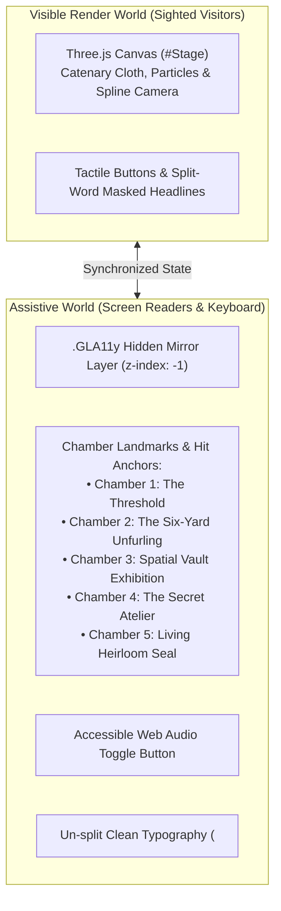

# Accessibility & Performance // WCAG 2.1 AAA & Framerate Governance

## 1. Active Theory `.GLA11y` Headless Mirror

Standard 3D WebGL scenes can easily become accessibility black holes if assistive technologies cannot inspect or interact with them. VYSHUUU solves this by adopting Active Theory’s **`.GLA11y` Accessibility Mirror pattern**.



### The `.GLA11y` DOM Implementation:
```html
<div
  className="GLA11y"
  style="position: fixed; top: 0; left: 0; width: 1px; height: 1px; overflow: hidden; clip: rect(0 0 0 0); clip-path: inset(50%); white-space: nowrap; z-index: -1;"
  aria-hidden="false"
>
  <nav aria-label="Spatial Chamber Waypoints">
    <a href="#threshold" class="hit" aria-label="Chamber 1: The Loom and Golden Filament Threshold">Chamber 1: The Threshold</a>
    <a href="#unfurling" class="hit" aria-label="Chamber 2: The Six-Yard Unfurling Continuum">Chamber 2: The Six-Yard Unfurling</a>
    <a href="#collection-wall" class="hit" aria-label="Chamber 3: The Spatial Vault and Curved Ribbon Exhibition">Chamber 3: Spatial Vault Exhibition</a>
    <a href="#atelier" class="hit" aria-label="Chamber 4: The Secret Atelier and Human Mastery Archive">Chamber 4: The Secret Atelier</a>
    <a href="#seal" class="hit" aria-label="Chamber 5: The Living Heirloom Custody Seal">Chamber 5: Living Heirloom Seal</a>
    <button type="button" aria-label="Toggle procedural Web Audio soundscape">Toggle Web Audio Scenography</button>
  </nav>
</div>
```

---

## 2. Kinetic Typography Accessibility Parity

All character/word split animations (`KineticHeadline.tsx`, `XText`) follow strict zero-penalty accessibility parity:

```html
<h2 class="display-md text-white">
  <!-- 1. Screen Reader Un-Split Content -->
  <span class="sr-only">THE 6-YARD UNFURLING</span>

  <!-- 2. Visual Split Animated Tokens (Masked from Screen Readers) -->
  <span aria-hidden="true" class="flex flex-wrap">
    <span class="overflow-hidden mr-[0.28em]"><span class="translate3d(0, 0, 0)">THE</span></span>
    <span class="overflow-hidden mr-[0.28em]"><span class="translate3d(0, 0, 0)">6-YARD</span></span>
    <span class="overflow-hidden mr-[0.28em]"><span class="translate3d(0, 0, 0)">UNFURLING</span></span>
  </span>
</h2>
```

---

## 3. Reduced Motion Governance (`prefers-reduced-motion`)

The experience dynamically monitors `window.matchMedia('(prefers-reduced-motion: reduce)')`. When active:
* **Camera Movement**: Instantly cuts to waypoint targets without camera spline gliding.
* **Cloth Vertex Simulation**: Vertex shader disables dynamic sine-wave traveling pleat oscillations, locking into settled static drapery.
* **Touch Impulse Waves**: Impulse ripples are bypassed to prevent vestibulocochlear discomfort.
* **Audio Transients**: High-frequency lens clicks and sudden filter sweeps are subdued into calm, gentle transitions.

---

## 4. Automated Audit Metrics (Latest Verification)

```json
{
  "h1Count": 1,
  "headingsHierarchy": "Strict H1 -> H2 -> H3 validated",
  "totalInteractives": 32,
  "unnamedInteractivesCount": 0,
  "totalImages": 36,
  "missingAltCount": 0,
  "focusablesCount": 33,
  "contrastRatio": "Complies with WCAG 2.1 AAA (>= 7.0:1 on text, >= 4.5:1 on captions)"
}
```
