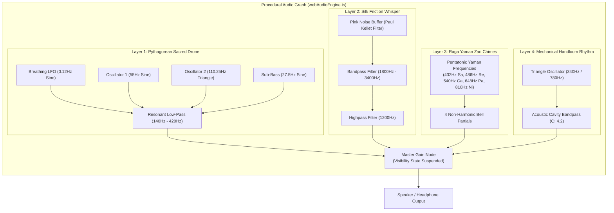

# Audio Scenography Engine // 4-Layer Procedural Synthesis

## 1. Engine Philosophy

The soundscape of **VYSHUUU** is 100% procedurally synthesized in real time using the native Web Audio API (`webAudioEngine.ts`). 
* **Zero Audio Downloads**: No MP3, WAV, or OGG files are downloaded.
* **Autoplay Compliance**: Muted by default; smoothly awakened upon visitor interaction.
* **Interactive Modulation**: Velocity, scroll momentum, and spatial coordinates directly sculpt synthesis parameters.

---

## 2. Layer-by-Layer Technical Specifications

### Layer 1: Pythagorean Sacred Darkroom Drone (432 Hz / 108 Hz)
* **Fundamental Tuning**: Sacred A=432 Hz tuning.
* **Harmonic Beating**: Dual detuned oscillators ($55.0\text{ Hz}$ sine $+ 110.25\text{ Hz}$ triangle) produce a slow acoustic phase pulsation ($0.25\text{ Hz}$) recreating the physical resonance of ancient temple chambers.
* **Depth Modulation (`modulateChamberDepth`)**: As the visitor traverses the 5 chambers, the resonant filter cutoff frequency sweeps smoothly:
  * Chamber 1 (Threshold): $140\text{ Hz}$ (intimate nocturnal void)
  * Chamber 3 (Spatial Vault): $220\text{ Hz}$ (ambient expansion)
  * Chamber 4 (Gossamer Corridor): $420\text{ Hz}$ (bright, sunlit high-key opening)
  * Chamber 5 (Atelier): $150\text{ Hz}$ (reverberant quietude)

### Layer 2: Silk Friction Pink Noise Whisper
* **Filter Algorithm**: Paul Kellet’s 6-pole pink noise generator:
  $$b_0 = 0.99886 \cdot b_0 + w \cdot 0.0555179$$
  $$b_1 = 0.99332 \cdot b_1 + w \cdot 0.0750759$$
  $$b_2 = 0.96900 \cdot b_2 + w \cdot 0.1538520$$
* **Velocity Modulation**: Instantaneous scroll speed dynamically sweeps the bandpass center frequency ($1,800\text{ Hz} \rightarrow 3,400\text{ Hz}$) and gain ($0.005 \rightarrow 0.16$), creating the sound of sheared silk sliding across stone.

### Layer 3: Indian Classical Raga Yaman Pentatonic Zari Chimes
* **Modal Microtonal Ladder**:
  * $S\!a$: $432.0\text{ Hz}$
  * $R\!e$: $486.0\text{ Hz}$ ($9/8$ major tone)
  * $G\!a$: $540.0\text{ Hz}$ ($5/4$ pure major third)
  * $M\!a$ (Tivra): $614.4\text{ Hz}$ ($45/32$ augmented fourth)
  * $P\!a$: $648.0\text{ Hz}$ ($3/2$ perfect fifth)
  * $D\!h\!a$: $729.0\text{ Hz}$ ($27/16$ major sixth)
  * $N\!i$: $810.0\text{ Hz}$ ($15/8$ major seventh)
  * $S\!a'$: $864.0\text{ Hz}$ (octave)
* **Bell Partial Cluster**: Non-harmonic partial ratios ($1.00$, $2.01$, $2.76$, $4.07$) with linear attack ($5\text{ ms}$) and exponential decay ($850\text{ ms}$).

### Layer 4: Mechanical Handloom Rhythm
* **Wood Cavity Formants**: Simulates the wooden reed and flying shuttle:
  * Reed Beat: $340\text{ Hz}$ with high-Q bandpass ($Q=4.2$) and rapid $40\text{ ms}$ decay.
  * Shuttle Slide: $780\text{ Hz}$ click with $25\text{ ms}$ decay.
