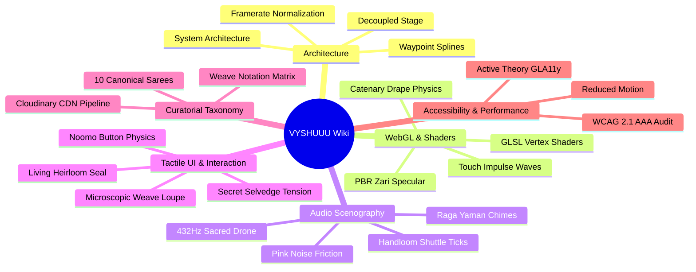

# VYSHUUU Technical Wiki // Home

Welcome to the **VYSHUUU** Technical Wiki. This documentation provides deep engineering insights, mathematical formulations, shader algorithms, and interaction physics governing the digital haute couture experience.

---

## Wiki Navigation Index

1. **[System Architecture](./System-Architecture.md)**: Deep dive into the Decoupled Stage, Waypoint Camera Spline, State Store, and Framerate Normalization.
2. **[WebGL Pipeline & Shaders](./WebGL-Pipeline-and-Shaders.md)**: Mathematical models for catenary drapery, traveling pleats, gold filaments, and anisotropic zari shaders.
3. **[Audio Scenography Engine](./Audio-Scenography-Engine.md)**: 100% Native Web Audio API procedural synthesis, Pythagorean tuning, and velocity modulation.
4. **[Tactile UI & Interaction](./Tactile-UI-and-Interaction.md)**: Noomo button micro-physics, dynamic cursor specular glow, spring tension mechanics, and 3D tilting seals.
5. **[Curatorial Taxonomy & Assets](./Curatorial-Taxonomy-and-Assets.md)**: 10 canonical saree archetypes, provenance rules, and the Cloudinary asset delivery pipeline.
6. **[Accessibility & Performance](./Accessibility-and-Performance.md)**: Active Theory `.GLA11y` headless mirror, WCAG 2.1 AAA conformance, and 60Hz/120Hz display optimization.

---

## Architectural Principles

* **Decoupled 3D Scenography**: The 3D WebGL canvas operates as a persistent full-screen background behind a transparent semantic DOM HUD.
* **Zero Reflow Interaction**: Cursor tracking, raking light beams, and hover spotlights use direct DOM CSS custom properties (`--x`, `--y`) and uniform mutations, completely bypassing React re-renders.
* **Zero Audio Downloads**: Every sound in the experience—from the 432 Hz darkroom drone to the metallic zari chimes—is synthesized procedurally in real time using the native Web Audio API.
* **Accessible Avant-Garde**: High-end creative development with zero accessibility penalty; visual kinetic typography and WebGL waypoints are completely mirrored for assistive technologies.
