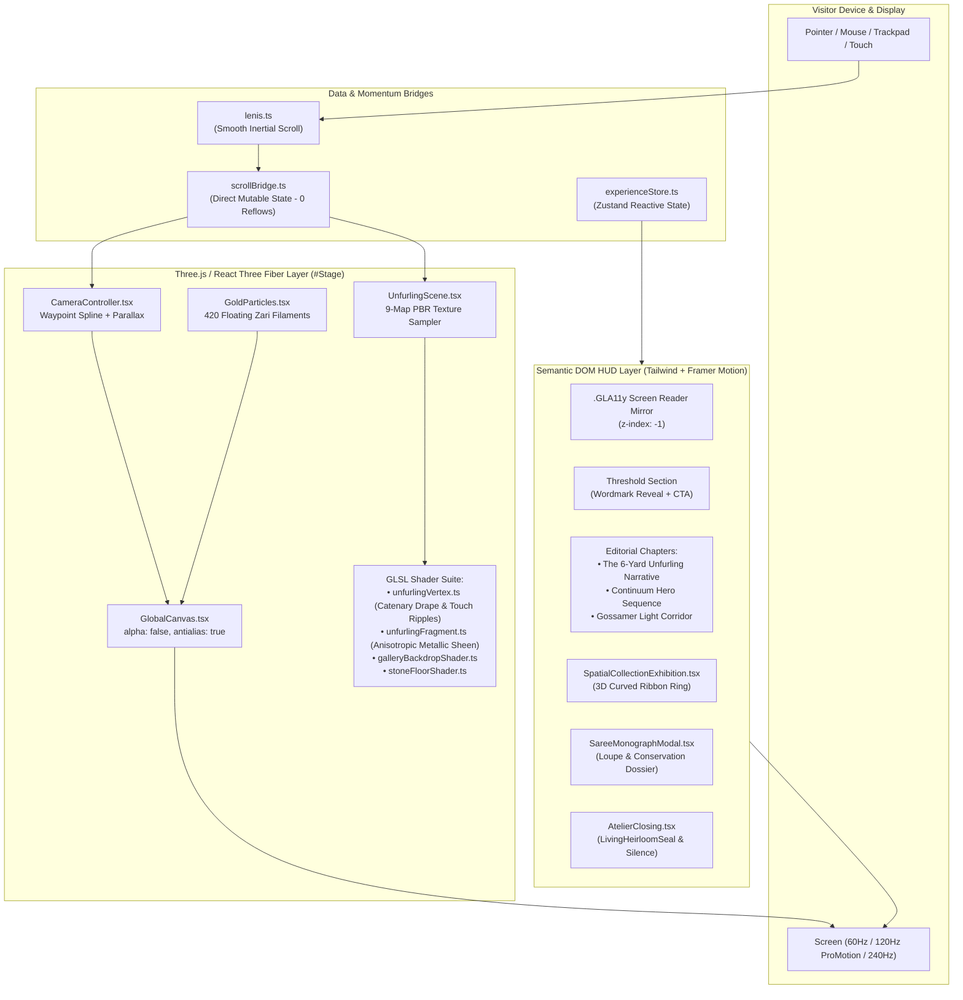

# System Architecture // Decoupled Scenography & Waypoint Splines

## 1. High-Level Architectural Topology

VYSHUUU abandons standard HTML document page boundaries in favor of a **Decoupled Scenography Architecture**. A persistent full-screen WebGL viewport operates in coordinate space behind a transparent semantic DOM HUD layer.



---

## 2. The 5-Chamber Waypoint Camera Spline

Camera coordinates glide through three-dimensional space as normalized global scroll progress $t \in [0.0, 1.0]$ advances:

```
Chamber 1: The Loom & Filament Threshold (0.00 <= t < 0.20)
  Camera Position: (0.0, 0.0, 5.8)  -> LookAt: (0.0, 0.0, 0.0)
  Atmosphere: Deep obsidian void; 420 micro-gold particles descending.

Chamber 2: The 6-Yard Unfurling Sanctuary (0.20 <= t < 0.45)
  Camera Position: (-0.08, 0.72, 3.82) -> LookAt: (-0.46, -0.68, 0.28)
  Atmosphere: Visceral 3/4 downward gaze over catenary pleats and spreading pallu.

Chamber 3: The Spatial Vault (0.45 <= t < 0.70)
  Camera Position: (0.35, 0.22, 4.30)  -> LookAt: (0.0, -0.12, 0.0)
  Atmosphere: Elevated vantage point framing the 10-saree cylindrical orbital ring.

Chamber 4: The Light Corridor (0.70 <= t < 0.88)
  Camera Position: (-0.22, -0.12, 3.35) -> LookAt: (0.08, 0.05, 0.0)
  Atmosphere: Macro high-key perspective looking through diaphanous ecru silk.

Chamber 5: The Secret Atelier & Living Heirloom Seal (0.88 <= t <= 1.00)
  Camera Position: (0.0, -0.32, 3.65)  -> LookAt: (0.0, -0.42, 0.0)
  Atmosphere: Intimate chiaroscuro focus, framing the Living Heirloom Seal.
```

---

## 3. Active Theory Framerate-Normalized Alpha

To eliminate visual pacing differences between 60 Hz mobile screens and 120 Hz / 240 Hz desktop monitors, all camera transitions and pointer springs utilize Active Theory's exponential framerate normalization formula:

$$\alpha_{\text{normalized}} = 1 - e^{\ln(1 - \alpha) \cdot \frac{\Delta t}{16.666\text{ ms}}}$$

Where:
* $\alpha \in [0, 1]$ is the nominal damp factor calibrated at 60 FPS ($16.666\text{ ms}$).
* $\Delta t$ is the actual instantaneous frame delta passed by the `useFrame` loop.

### Mathematical Proof
At 60 FPS ($\Delta t = 16.666\text{ ms}$):
$$\alpha_{\text{normalized}} = 1 - e^{\ln(1 - \alpha) \cdot 1} = 1 - (1 - \alpha) = \alpha$$

At 120 FPS ($\Delta t = 8.333\text{ ms}$):
$$\alpha_{\text{normalized}} = 1 - e^{\ln(1 - \alpha) \cdot 0.5} = 1 - \sqrt{1 - \alpha}$$
Applying this twice yields exactly $(1 - \alpha)$, guaranteeing the exact same spatial displacement over any given physical wall-clock duration.
