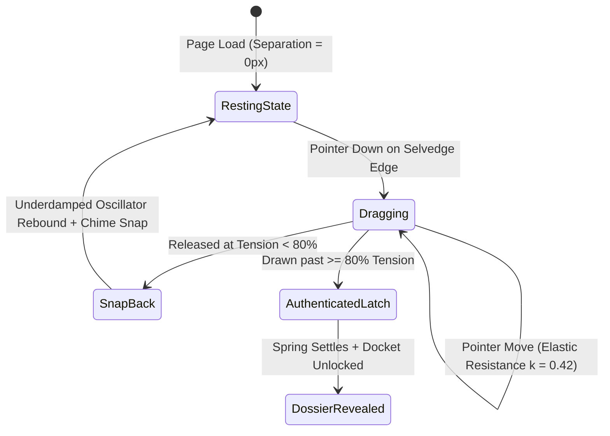

# Tactile UI & Interaction // Physics, Buttons & Gestures

## 1. Noomo-Grade Button Micro-Physics (`TactileGlowButton.tsx`)

Buttons in VYSHUUU are constructed not as flat CSS boxes, but as physical multi-layered light and texture composites.

```mermaid
flowchart TD
    subgraph TactileButton["TactileGlowButton Composition"]
        SVGWrap["1. Elastic SVG Border Envelope\nvector-effect='non-scaling-stroke'\nscale(.96, .85) -> scale(1.0, 1.0)"]
        NoiseBurn["2. Analog Woven Grain Overlay\nSVG fractal noise with mix-blend-mode: overlay"]
        CursorGlow["3. Dynamic Inset Specular Spotlight\ntranslate3d(calc(var(--x) - 50%), calc(var(--y) - 50%), 0)"]
        DualBloom["4. Dual-Chromatic Gel Glows\nAntique Gold (top-left) + Sindoor Crimson (bottom-right)"]
        Label["5. Typographic Inscription & Arrow\nMono tracking [0.24em] + drop shadow"]
    end

    PointerMove["Pointer Move Event"] -->|Injects --x, --y| CursorGlow
    HoverEvent["Pointer Enter Event"] -->|scale(1, 1)| SVGWrap
    HoverEvent -->|Awakens +scale(1)| DualBloom
    HoverEvent -->|Triggers| AudioChime["Raga Yaman Zari Chime"]
    ClickEvent["Pointer Click Event"] -->|Triggers| AudioClick["Handloom Reed Click"]
```

### CSS Custom Properties Architecture
When the visitor hovers over any `TactileGlowButton`, the bounding box coordinates are mapped continuously:
```typescript
const handlePointerMove = (e: React.PointerEvent<HTMLButtonElement>) => {
  const rect = e.currentTarget.getBoundingClientRect();
  const x = ((e.clientX - rect.left) / rect.width) * 100;
  const y = ((e.clientY - rect.top) / rect.height) * 100;
  e.currentTarget.style.setProperty('--x', `${x}%`);
  e.currentTarget.style.setProperty('--y', `${y}%`);
};
```
This directly moves the 20px blurred radial gradient beneath the text with **zero layout reflows and zero React state changes**.

---

## 2. Audio-Tactile Secret Selvedge Gesture (`SecretSelvedgeGesture.tsx`)

An intimate gesture interaction anchored to the selvedge of the textile.



### Underdamped Harmonic Oscillator Formulation
Upon premature release, the separated gold thread snaps back to the cloth boundary using damped physical oscillation:

$$x(t) = A_0 \cdot e^{-\zeta \cdot t} \cdot \cos(\omega \cdot t)$$

Where:
* $A_0$ is the initial separation displacement at release.
* $\zeta = 0.0075\text{ ms}^{-1}$ is the decay damping factor.
* $\omega = 0.024\text{ rad/ms}$ is the oscillation frequency.
* An audio chime snap (`audioEngine.triggerSpringSnap()`) and optional haptic pulse (`navigator.vibrate([10, 25, 8])`) execute at $t=0$.

---

## 3. The Living Heirloom Seal (`LivingHeirloomSeal.tsx`)

The closing monolithic gold seal responds to pointer orientation via 3D matrix transforms:

$$\text{Tilt}_X = \left(\frac{y - y_{\text{center}}}{h}\right) \cdot \theta_{\text{max}}$$
$$\text{Tilt}_Y = -\left(\frac{x - x_{\text{center}}}{w}\right) \cdot \theta_{\text{max}}$$

* **Specular Reflection**: An anisotropic highlight follows the inverse vector of the pointer, giving the medal physical 3D relief.
* **108 Hz Awakening**: Clicking or tapping awakens a 108 Hz sacred harmonic singing bowl with a 2.8-second reverberant decay.
