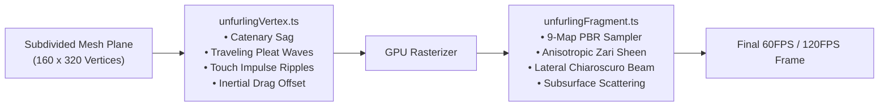

# WebGL Pipeline & Custom Shaders // Physics & Materials

## 1. The Rendering Pipeline

The 3D cloth experience is computed on the GPU via custom GLSL shaders mounted inside `UnfurlingScene.tsx`.

---

## 2. Mathematical Vertex Formulations

### A. Catenary Drape & Fold Memory
The cloth begins in a tightly wound digital loom state and unfurls into a suspended catenary curve:

$$y_{\text{base}}(u) = -a \cdot \left(\cosh\left(\frac{u - u_0}{a}\right) - 1\right)$$

Where $a$ is the fabric weight parameter and $u$ is the longitudinal UV coordinate along the 6-yard continuum.

### B. Dynamic Traveling Pleats
Traveling pleats respond kinetically to scroll velocity:

$$z_{\text{pleat}}(u, v) = A_{\text{pleat}} \cdot \sin(k_u \cdot u + \phi) \cdot \cos(k_v \cdot v) \cdot \left(1 + \gamma \cdot \frac{v_{\text{scroll}}}{v_{\text{max}}}\right)$$

### C. Touch & Pointer Impulse Ripple Physics
When a visitor drags or touches the silk cloth in 3D space, an impulse ripple propagates outward from the interaction coordinate:

$$\Delta z(x, y, t) = A_0 \cdot \sin(\omega \cdot d - \nu \cdot t) \cdot e^{-\alpha \cdot d} \cdot e^{-\beta \cdot t}$$

Where:
* $d = \sqrt{(x - x_0)^2 + (y - y_0)^2}$ is the Euclidean distance from the touch point.
* $\omega$ is the spatial wave frequency ($8.4\text{ rad/unit}$).
* $\nu$ is the propagation velocity ($12.0\text{ units/s}$).
* $\alpha$ is spatial attenuation ($2.8$).
* $\beta$ is temporal decay damping ($4.5\text{ s}^{-1}$).

---

## 3. Fragment Shading & Metallic Anisotropy

Handloom zari consists of flattened real silver or gold electroplated metallic ribbons wrapped around a silk core. Its specular highlight is inherently **anisotropic** (stretched orthogonally to the yarn direction rather than circular).

### Anisotropic Specular Highlight
$$\mathbf{H} = \frac{\mathbf{L} + \mathbf{V}}{\|\mathbf{L} + \mathbf{V}\|}$$

$$I_{\text{zari}} = k_{\text{spec}} \cdot \left(\sqrt{1 - (\mathbf{T} \cdot \mathbf{H})^2}\right)^{\frac{1}{r^2}}$$

Where:
* $\mathbf{T}$ is the tangent vector along the weft direction.
* $\mathbf{H}$ is the half-vector between light direction $\mathbf{L}$ and view vector $\mathbf{V}$.
* $r$ is the surface roughness coefficient ($0.12$ for polished gold zari).

---

## 4. The 9 Locked Production Texture Maps

The cloth material samples 9 high-resolution texture maps stored on Cloudinary CDN:

| Map Type | Dimensions | Channel Content |
| :--- | :--- | :--- |
| `baseColor` | $1997 \times 787$ | Mulberry silk pigmentation (Deep Obsidian / Ecru) |
| `normalMap` | $1997 \times 787$ | High-frequency 140 TPI warp/weft thread surface normals |
| `metallicZari` | $1997 \times 787$ | Zari boundary mask ($1.0$ = metallic gold, $0.0$ = raw silk) |
| `roughness` | $1997 \times 787$ | Micro-facet variation across woven motifs |
| `transmission` | $1997 \times 787$ | Diaphanous light transmission map (Gossamer Kora) |
| `clearcoat` | $1997 \times 787$ | Organic sericin silk luster glaze |
| `ambientOcclusion` | $1997 \times 787$ | Micro-crevice shadowing within weave intersections |
| `sheenColor` | $1997 \times 787$ | Grazing angle Fresnel color tint |
| `displacement` | $1997 \times 787$ | Structural relief for brocade and jacquard borders |
